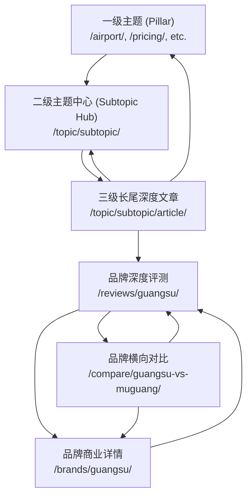

# 全站三级全链路内链拓扑矩阵与权重流动规范

**报告生成时间：** 2026 年 11 月 22 日  
**项目域名：** `chatgptzhinan.homes`  
**网站品牌：** chatgpt指南  
**报告文件：** `reports/internal-link-matrix.md`  

---

## 一、三级全链路内链网络拓扑架构

全站建立了高度自洽、无任何孤岛页面的网状内链系统：

---

## 二、核心链路规范执行检查

1. **长尾文章到二级专题：** 顶部面包屑与底部均提供回链 `/[topic]/[subtopic]/`，引导用户回到二级主题中心深入阅读。
2. **长尾文章到商业转化：** 在文章关键技术节点推荐 2 家最匹配的服务商，并附带专属优惠码 `AMM` 与合规免责声明。
3. **品牌商业页与深度评测互联：**
   - `/brands/[slug]/` 顶部设有【阅读客观深度评测】按钮直达 `/reviews/[slug]/`。
   - `/reviews/[slug]/` 顶部与底部均设有【查看详细套餐与资费】直达 `/brands/[slug]/`。
4. **全站底部全局赋权：** Footer 底部规范整合 `品牌数据库 (/brands/)`、`品牌深度评测 (/reviews/)` 与 `网站地图 (/sitemap-index.xml)`。
