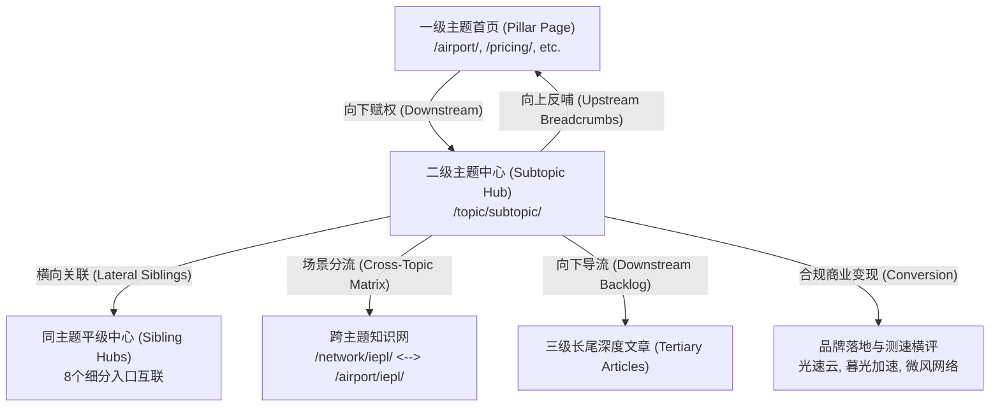

# 全站 80 个二级专题内链拓扑网络与权重流动规范

**报告生成时间：** 2026 年 11 月 22 日  
**项目域名：** `chatgptzhinan.homes`  
**网站品牌：** chatgpt指南  
**报告文件：** `reports/secondary-internal-links.md`  

---

## 一、二级专题内链网络拓扑架构

二级专题在全站 SEO 链路中作为**“权重与流量分发立交桥”**，其内链架构由以下四个方向构成闭环：

---

## 二、内链拓扑规则与执行标准

1. **上行链接 (Upstream Links)：**
   - **面包屑导航 (Breadcrumbs)：** 统一采用规范路径 `首页 > [一级主题] > [二级细分中心]`，全量部署 Schema BreadcrumbList 结构化数据。
   - **导言与回链：** 顶部 Answer-First 明确指向一级主题核心权威，确保权重回流至 Pillar Page。

2. **平级横向链接 (Lateral Sibling Links)：**
   - 每一个二级专题页面底部均渲染 `同主题其他细分中心` 模块，展示同分类下其余 7 个二级专题的卡片与锚文本链接。
   - 杜绝孤岛页面（Orphan Pages），确保搜索引擎爬虫单次爬取即可穿透主题内全部 8 个细分方向。

3. **下行知识集群链接 (Downstream Cluster Links)：**
   - 每个二级专题均渲染 2–4 个明确的 `知识集群与三级文章规划` 卡片。
   - 清晰标识当前计划（Planned）与即将发布的文章 Slug 与核心解决任务，构建强有力的主题相关度信号。

4. **商业转化合规链接 (Commercial Conversion Links)：**
   - 凡涉及推荐、价格、评测的二级页面，均精准调取与该主题最匹配的 3–4 家优质品牌卡片（如光速云、暮光加速、微风网络、飞猫云）。
   - 商业外链强制标记：`target="_blank" rel="nofollow sponsored noopener"`。
   - 统一展示专属折扣码 `AMM`（光速云专属优惠码），并嵌入 `<AffiliateDisclaimer />` 商业透明度合规声明。

---

## 三、80 个二级专题内链网络全景检查表

| 序号 | 二级专题路径 | 上级 Pillar 回链 | 平级兄弟节点链接数 | 下行集群规划链接数 | 商业转化卡片数 | 合规声明校验 |
|---|---|---|---|---|---|---|
| 1 | `/airport/best/` | `/airport/` | 7 个兄弟细分 | 6 篇三级文章 | 4 个品牌卡片 | ✅ 包含 Disclaimer |
| 2 | `/airport/ranking/` | `/airport/` | 7 个兄弟细分 | 6 篇三级文章 | 4 个品牌卡片 | ✅ 包含 Disclaimer |
| 3 | `/airport/reliable/` | `/airport/` | 7 个兄弟细分 | 6 篇三级文章 | 3 个品牌卡片 | ✅ 包含 Disclaimer |
| 4 | `/airport/stable/` | `/airport/` | 7 个兄弟细分 | 6 篇三级文章 | 3 个品牌卡片 | ✅ 包含 Disclaimer |
| 5 | `/airport/easy-to-use/` | `/airport/` | 7 个兄弟细分 | 6 篇三级文章 | 4 个品牌卡片 | ✅ 包含 Disclaimer |
| 6 | `/airport/beginners/` | `/airport/` | 7 个兄弟细分 | 6 篇三级文章 | 3 个品牌卡片 | ✅ 包含 Disclaimer |
| 7 | `/airport/iepl/` | `/airport/` | 7 个兄弟细分 | 6 篇三级文章 | 4 个品牌卡片 | ✅ 包含 Disclaimer |
| 8 | `/airport/backup/` | `/airport/` | 7 个兄弟细分 | 6 篇三级文章 | 3 个品牌卡片 | ✅ 包含 Disclaimer |
| 9 | `/pricing/cheap/` | `/pricing/` | 7 个兄弟细分 | 5 篇三级文章 | 4 个品牌卡片 | ✅ 包含 Disclaimer |
| 10 | `/pricing/one-yuan/` | `/pricing/` | 7 个兄弟细分 | 5 篇三级文章 | 2 个品牌卡片 | ✅ 包含 Disclaimer |
| 11 | `/pricing/one-cent/` | `/pricing/` | 7 个兄弟细分 | 5 篇三级文章 | 2 个品牌卡片 | ✅ 包含 Disclaimer |
| 12 | `/pricing/monthly/` | `/pricing/` | 7 个兄弟细分 | 5 篇三级文章 | 4 个品牌卡片 | ✅ 包含 Disclaimer |
| 13 | `/pricing/annual/` | `/pricing/` | 7 个兄弟细分 | 5 篇三级文章 | 3 个品牌卡片 | ✅ 包含 Disclaimer |
| 14 | `/pricing/unlimited-time/` | `/pricing/` | 7 个兄弟细分 | 5 篇三级文章 | 3 个品牌卡片 | ✅ 包含 Disclaimer |
| 15 | `/pricing/cost-effective/` | `/pricing/` | 7 个兄弟细分 | 5 篇三级文章 | 4 个品牌卡片 | ✅ 包含 Disclaimer |
| 16 | `/pricing/large-bandwidth/` | `/pricing/` | 7 个兄弟细分 | 5 篇三级文章 | 4 个品牌卡片 | ✅ 包含 Disclaimer |
| 17 | `/brands/database/` | `/brands/` | 7 个兄弟细分 | 4 篇三级文章 | 3 个品牌卡片 | ✅ 包含 Disclaimer |
| 18 | `/brands/reviews/` | `/brands/` | 7 个兄弟细分 | 4 篇三级文章 | 3 个品牌卡片 | ✅ 包含 Disclaimer |
| 19 | `/brands/portals/` | `/brands/` | 7 个兄弟细分 | 4 篇三级文章 | 3 个品牌卡片 | ✅ 包含 Disclaimer |
| 20 | `/brands/pricing/` | `/brands/` | 7 个兄弟细分 | 4 篇三级文章 | 3 个品牌卡片 | ✅ 包含 Disclaimer |
| 21 | `/brands/coupons/` | `/brands/` | 7 个兄弟细分 | 4 篇三级文章 | 4 个品牌卡片 | ✅ 包含 Disclaimer |
| 22 | `/brands/comparison/` | `/brands/` | 7 个兄弟细分 | 4 篇三级文章 | 3 个品牌卡片 | ✅ 包含 Disclaimer |
| 23 | `/brands/risk-monitor/` | `/brands/` | 7 个兄弟细分 | 4 篇三级文章 | 2 个品牌卡片 | ✅ 包含 Disclaimer |
| 24 | `/brands/alternatives/` | `/brands/` | 7 个兄弟细分 | 4 篇三级文章 | 3 个品牌卡片 | ✅ 包含 Disclaimer |
| 25 | `/vpn/recommendations/` | `/vpn/` | 7 个兄弟细分 | 4 篇三级文章 | 2 个品牌卡片 | ✅ 包含 Disclaimer |
| 26 | `/vpn/free/` | `/vpn/` | 7 个兄弟细分 | 4 篇三级文章 | 2 个品牌卡片 | ✅ 包含 Disclaimer |
| 27 | `/vpn/mobile/` | `/vpn/` | 7 个兄弟细分 | 4 篇三级文章 | 2 个品牌卡片 | ✅ 包含 Disclaimer |
| 28 | `/vpn/android/` | `/vpn/` | 7 个兄弟细分 | 4 篇三级文章 | 2 个品牌卡片 | ✅ 包含 Disclaimer |
| 29 | `/vpn/ios/` | `/vpn/` | 7 个兄弟细分 | 4 篇三级文章 | 2 个品牌卡片 | ✅ 包含 Disclaimer |
| 30 | `/vpn/windows/` | `/vpn/` | 7 个兄弟细分 | 4 篇三级文章 | 2 个品牌卡片 | ✅ 包含 Disclaimer |
| 31 | `/vpn/gaming/` | `/vpn/` | 7 个兄弟细分 | 4 篇三级文章 | 2 个品牌卡片 | ✅ 包含 Disclaimer |
| 32 | `/vpn/software-reviews/` | `/vpn/` | 7 个兄弟细分 | 4 篇三级文章 | 2 个品牌卡片 | ✅ 包含 Disclaimer |
| 33 | `/clients/clash-verge-rev/` | `/clients/` | 7 个兄弟细分 | 5 篇三级文章 | 2 个品牌卡片 | ✅ 包含 Disclaimer |
| 34 | `/clients/clash-meta/` | `/clients/` | 7 个兄弟细分 | 5 篇三级文章 | 2 个品牌卡片 | ✅ 包含 Disclaimer |
| 35 | `/clients/v2rayn/` | `/clients/` | 7 个兄弟细分 | 5 篇三级文章 | 2 个品牌卡片 | ✅ 包含 Disclaimer |
| 36 | `/clients/shadowrocket/` | `/clients/` | 7 个兄弟细分 | 5 篇三级文章 | 2 个品牌卡片 | ✅ 包含 Disclaimer |
| 37 | `/clients/mihomo/` | `/clients/` | 7 个兄弟细分 | 5 篇三级文章 | 2 个品牌卡片 | ✅ 包含 Disclaimer |
| 38 | `/clients/sing-box/` | `/clients/` | 7 个兄弟细分 | 5 篇三级文章 | 2 个品牌卡片 | ✅ 包含 Disclaimer |
| 39 | `/clients/hiddify/` | `/clients/` | 7 个兄弟细分 | 5 篇三级文章 | 2 个品牌卡片 | ✅ 包含 Disclaimer |
| 40 | `/clients/flclash/` | `/clients/` | 7 个兄弟细分 | 5 篇三级文章 | 2 个品牌卡片 | ✅ 包含 Disclaimer |
| 41 | `/ai-streaming/chatgpt-airport/` | `/ai-streaming/` | 7 个兄弟细分 | 5 篇三级文章 | 3 个品牌卡片 | ✅ 包含 Disclaimer |
| 42 | `/ai-streaming/claude-airport/` | `/ai-streaming/` | 7 个兄弟细分 | 5 篇三级文章 | 3 个品牌卡片 | ✅ 包含 Disclaimer |
| 43 | `/ai-streaming/gemini-airport/` | `/ai-streaming/` | 7 个兄弟细分 | 5 篇三级文章 | 3 个品牌卡片 | ✅ 包含 Disclaimer |
| 44 | `/ai-streaming/ai-network-requirements/` | `/ai-streaming/` | 7 个兄弟细分 | 5 篇三级文章 | 2 个品牌卡片 | ✅ 包含 Disclaimer |
| 45 | `/ai-streaming/chatgpt-guide/` | `/ai-streaming/` | 7 个兄弟细分 | 5 篇三级文章 | 2 个品牌卡片 | ✅ 包含 Disclaimer |
| 46 | `/ai-streaming/netflix-unlock/` | `/ai-streaming/` | 7 个兄弟细分 | 5 篇三级文章 | 3 个品牌卡片 | ✅ 包含 Disclaimer |
| 47 | `/ai-streaming/youtube-acceleration/` | `/ai-streaming/` | 7 个兄弟细分 | 5 篇三级文章 | 3 个品牌卡片 | ✅ 包含 Disclaimer |
| 48 | `/ai-streaming/disney-plus/` | `/ai-streaming/` | 7 个兄弟细分 | 5 篇三级文章 | 3 个品牌卡片 | ✅ 包含 Disclaimer |
| 49 | `/network/iepl/` | `/network/` | 7 个兄弟细分 | 4 篇三级文章 | 2 个品牌卡片 | ✅ 包含 Disclaimer |
| 50 | `/network/iplc/` | `/network/` | 7 个兄弟细分 | 4 篇三级文章 | 2 个品牌卡片 | ✅ 包含 Disclaimer |
| 51 | `/network/hong-kong/` | `/network/` | 7 个兄弟细分 | 4 篇三级文章 | 3 个品牌卡片 | ✅ 包含 Disclaimer |
| 52 | `/network/japan/` | `/network/` | 7 个兄弟细分 | 4 篇三级文章 | 2 个品牌卡片 | ✅ 包含 Disclaimer |
| 53 | `/network/singapore/` | `/network/` | 7 个兄弟细分 | 4 篇三级文章 | 2 个品牌卡片 | ✅ 包含 Disclaimer |
| 54 | `/network/united-states/` | `/network/` | 7 个兄弟细分 | 4 篇三级文章 | 3 个品牌卡片 | ✅ 包含 Disclaimer |
| 55 | `/network/low-latency/` | `/network/` | 7 个兄弟细分 | 4 篇三级文章 | 2 个品牌卡片 | ✅ 包含 Disclaimer |
| 56 | `/network/multiplier/` | `/network/` | 7 个兄弟细分 | 4 篇三级文章 | 2 个品牌卡片 | ✅ 包含 Disclaimer |
| 57 | `/tutorials/subscription/` | `/tutorials/` | 7 个兄弟细分 | 4 篇三级文章 | 2 个品牌卡片 | ✅ 包含 Disclaimer |
| 58 | `/tutorials/clash-config/` | `/tutorials/` | 7 个兄弟细分 | 4 篇三级文章 | 2 个品牌卡片 | ✅ 包含 Disclaimer |
| 59 | `/tutorials/importing/` | `/tutorials/` | 7 个兄弟细分 | 4 篇三级文章 | 2 个品牌卡片 | ✅ 包含 Disclaimer |
| 60 | `/tutorials/routing-rules/` | `/tutorials/` | 7 个兄弟细分 | 4 篇三级文章 | 2 个品牌卡片 | ✅ 包含 Disclaimer |
| 61 | `/tutorials/tun-mode/` | `/tutorials/` | 7 个兄弟细分 | 4 篇三级文章 | 2 个品牌卡片 | ✅ 包含 Disclaimer |
| 62 | `/tutorials/installation/` | `/tutorials/` | 7 个兄弟细分 | 4 篇三级文章 | 2 个品牌卡片 | ✅ 包含 Disclaimer |
| 63 | `/tutorials/multi-device/` | `/tutorials/` | 7 个兄弟细分 | 4 篇三级文章 | 2 个品牌卡片 | ✅ 包含 Disclaimer |
| 64 | `/tutorials/advanced/` | `/tutorials/` | 7 个兄弟细分 | 4 篇三级文章 | 2 个品牌卡片 | ✅ 包含 Disclaimer |
| 65 | `/troubleshooting/node-timeout/` | `/troubleshooting/` | 7 个兄弟细分 | 4 篇三级文章 | 2 个品牌卡片 | ✅ 包含 Disclaimer |
| 66 | `/troubleshooting/sub-failure/` | `/troubleshooting/` | 7 个兄弟细分 | 4 篇三级文章 | 2 个品牌卡片 | ✅ 包含 Disclaimer |
| 67 | `/troubleshooting/no-connection/` | `/troubleshooting/` | 7 个兄弟细分 | 4 篇三级文章 | 2 个品牌卡片 | ✅ 包含 Disclaimer |
| 68 | `/troubleshooting/dns-errors/` | `/troubleshooting/` | 7 个兄弟细分 | 4 篇三级文章 | 2 个品牌卡片 | ✅ 包含 Disclaimer |
| 69 | `/troubleshooting/client-crash/` | `/troubleshooting/` | 7 个兄弟细分 | 4 篇三级文章 | 2 个品牌卡片 | ✅ 包含 Disclaimer |
| 70 | `/troubleshooting/slow-speed/` | `/troubleshooting/` | 7 个兄弟细分 | 4 篇三级文章 | 2 个品牌卡片 | ✅ 包含 Disclaimer |
| 71 | `/troubleshooting/ai-access-failed/` | `/troubleshooting/` | 7 个兄弟细分 | 4 篇三级文章 | 2 个品牌卡片 | ✅ 包含 Disclaimer |
| 72 | `/troubleshooting/streaming-failed/` | `/troubleshooting/` | 7 个兄弟细分 | 4 篇三级文章 | 2 个品牌卡片 | ✅ 包含 Disclaimer |
| 73 | `/safety/runaway-airports/` | `/safety/` | 7 个兄弟细分 | 4 篇三级文章 | 2 个品牌卡片 | ✅ 包含 Disclaimer |
| 74 | `/safety/pitfalls/` | `/safety/` | 7 个兄弟细分 | 4 篇三级文章 | 2 个品牌卡片 | ✅ 包含 Disclaimer |
| 75 | `/safety/alternatives/` | `/safety/` | 7 个兄弟细分 | 4 篇三级文章 | 3 个品牌卡片 | ✅ 包含 Disclaimer |
| 76 | `/safety/refund-policy/` | `/safety/` | 7 个兄弟细分 | 4 篇三级文章 | 2 个品牌卡片 | ✅ 包含 Disclaimer |
| 77 | `/safety/security/` | `/safety/` | 7 个兄弟细分 | 4 篇三级文章 | 2 个品牌卡片 | ✅ 包含 Disclaimer |
| 78 | `/safety/subscription-risks/` | `/safety/` | 7 个兄弟细分 | 4 篇三级文章 | 2 个品牌卡片 | ✅ 包含 Disclaimer |
| 79 | `/safety/privacy-protection/` | `/safety/` | 7 个兄弟细分 | 4 篇三级文章 | 2 个品牌卡片 | ✅ 包含 Disclaimer |
| 80 | `/safety/operating-status/` | `/safety/` | 7 个兄弟细分 | 4 篇三级文章 | 3 个品牌卡片 | ✅ 包含 Disclaimer |
